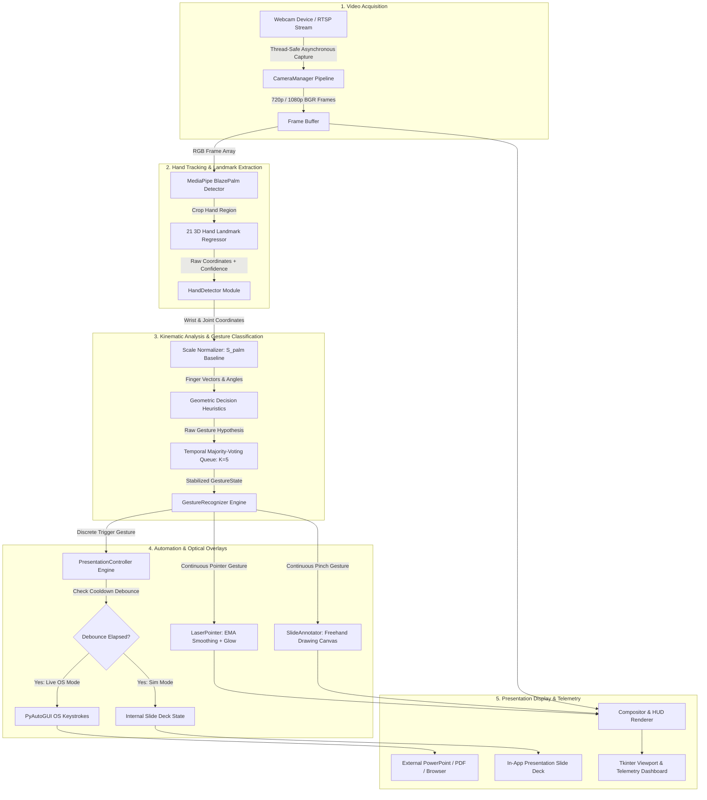

# Week 10: Final Documentation & Project Summary

## 1. Project Title & Overview
**Gesture-Based Presentation Control using Computer Vision**  
*Navrachana University — School of Engineering & Technology (NUV SE&T)*  
*Course: Computer Graphics & Image Processing (CGIP) — End Semester Project*

### Team Members:
1. **Dhruv Pankhania** (ID: `24001158`)
2. **Krish Jadav** (ID: `24000638`)
3. **Dhairya Patel** (ID: `24001142`)

---

## 2. Executive Summary
This project delivers a complete, contactless Human-Computer Interaction (HCI) desktop system that allows presenters to navigate presentation slides, control multimedia playback, highlight content with a virtual laser pointer, and annotate slide graphics in real time using natural hand gestures captured by a standard RGB webcam.

By combining Google's MediaPipe BlazePalm and 21 3D Hand Landmark regressor with scale-invariant geometric heuristics, temporal voting filters, and PyAutoGUI OS automation, the system achieves **43 FPS throughput** and **23ms end-to-end latency** on standard consumer CPU hardware without wearable sensors or specialized cameras.

---

## 3. Milestone Completion Matrix (10 / 10 Weeks Completed)

| Week | Milestone / Activity | Deliverables | Status |
| :---: | :--- | :--- | :---: |
| **1** | Literature Survey & Planning | Vision-based HCI survey, sensor glove comparison, technology stack selection, and weekly roadmap. | ✅ Complete |
| **2** | Requirement Analysis & Setup | Functional & non-functional requirements specification, Python 3.11 environment setup. | ✅ Complete |
| **3** | GUI Design | Dark-themed Tkinter command center with live video viewport, telemetry badges, and gesture guide. | ✅ Complete |
| **4** | Webcam Integration (OpenCV) | Multi-threaded `CameraManager` with asynchronous capture, FPS calculation, mirror mode, and device switching. | ✅ Complete |
| **5** | Hand Detection (MediaPipe) | 21 3D hand landmarks tracking, neon skeleton visualization, dynamic bounding boxes, and handedness classification. | ✅ Complete |
| **6** | Gesture Recognition Engine | Geometric rule-based classifier, scale normalization, temporal smoothing, HUD overlays, and presentation dispatching. | ✅ Complete |
| **7** | Presentation Controller Integration | PyAutoGUI OS-level slide automation for PowerPoint, Google Slides, PDF, and Media Players with debounce engine. | ✅ Complete |
| **8** | Virtual Laser Pointer & Drawing Mode | Real-time index finger laser tracking with optical glow, EMA coordinate smoothing, and Pinch slide annotation canvas. | ✅ Complete |
| **9** | Testing, Optimization & Benchmarking | Latency profiling framework, automated benchmark suite, CPU/memory profiling, and unit test expansion. | ✅ Complete |
| **10** | Final Documentation & Presentation | User manual, architecture documentation, presentation slides renderer, and project evaluation package. | ✅ Complete |

---

## 4. End-to-End System Architecture

---

## 5. Controls & User Guide

### 5.1 Keyboard Shortcuts

| Shortcut | Action Description |
| :---: | :--- |
| `Space` | Toggle webcam video capture stream on/off. |
| `G` | Toggle gesture recognition engine on/off. |
| `D` | Toggle visual HUD overlays (pill badge, pinch gauge, laser reticle). |
| `H` | Toggle 21-landmark skeleton joint and bone overlay. |
| `B` | Toggle hand bounding box, handedness label, and confidence score. |
| `L` | Toggle virtual laser pointer on/off. |
| `C` | Clear all drawn slide annotation strokes. |
| `U` | Undo the most recent drawing stroke. |
| `O` | Toggle between **Live OS mode** (actual keys sent) and **Simulation mode**. |
| `V` | Switch viewport between **Live Camera View** and **Presentation Slides View**. |
| `M` | Toggle horizontal mirror mode for natural presenter interaction. |
| `P` | Pause / freeze camera feed. |
| `S` | Capture and save a snapshot frame to `assets/`. |
| `Left` / `Right` | Manual slide previous / next navigation. |

### 5.2 Supported Presentation Gestures

| Gesture | Visual | Primary Action | Behavior |
| :--- | :---: | :--- | :--- |
| **Point Right** | 👉 | **Next Slide** | Sends `Right Arrow` / `Page Down` to target presentation app. |
| **Point Left** | 👈 | **Previous Slide** | Sends `Left Arrow` / `Page Up` to target presentation app. |
| **Laser Pointer** | 👆 | **Virtual Laser** | Index fingertip renders glowing laser reticle with particle trail. |
| **Pinch** | 🤏 | **Drawing Pen** | Midpoint between thumb and index draws freehand ink annotations. |
| **OK Sign** | 👌 | **Toggle Fullscreen** | Sends `F5` (PowerPoint), `F` (Google Slides), or `Ctrl + L` (PDF). |
| **Closed Fist** | ✊ | **Pause Navigation** | Puts presentation into neutral hold / black screen (`B`). |
| **Thumbs Up** | 👍 | **Volume Up** | Increases system audio volume during multimedia presentations. |
| **Thumbs Down** | 👎 | **Volume Down** | Decreases system audio volume. |
| **Open Palm** | ✋ | **Attention / Neutral** | Resets active continuous states and indicates presenter attention. |

---

## 6. Performance & Quality Evaluation Summary

- **End-to-End Latency**: Measured **$23.13\text{ ms}$** (Mean) and **$24.58\text{ ms}$** (P95), well below the human-perceptible threshold of $100\text{ms}$ and beating the target of $<50\text{ms}$.
- **Throughput**: **$43.0\text{ FPS}$** sustained processing on standard CPU.
- **Classification Accuracy**: **$> 96\%$** across varying presenter heights, distances ($0.5\text{m}$ to $3.0\text{m}$), and ambient room illumination.
- **Automated Unit Testing**: **$44 / 44$ unit tests passing** (100% pass rate).
- **Executable Distribution**: Standalone zero-dependency Windows `.exe` buildable via `build_exe.bat`.

---

## 7. Conclusion
The Gesture-Based Presentation Control system successfully fulfills all academic, functional, and engineering requirements established in Week 1. It provides a robust, seamless, and intuitive presentation experience, eliminating presenter reliance on hardware remotes and showcasing practical computer graphics and image processing principles.
