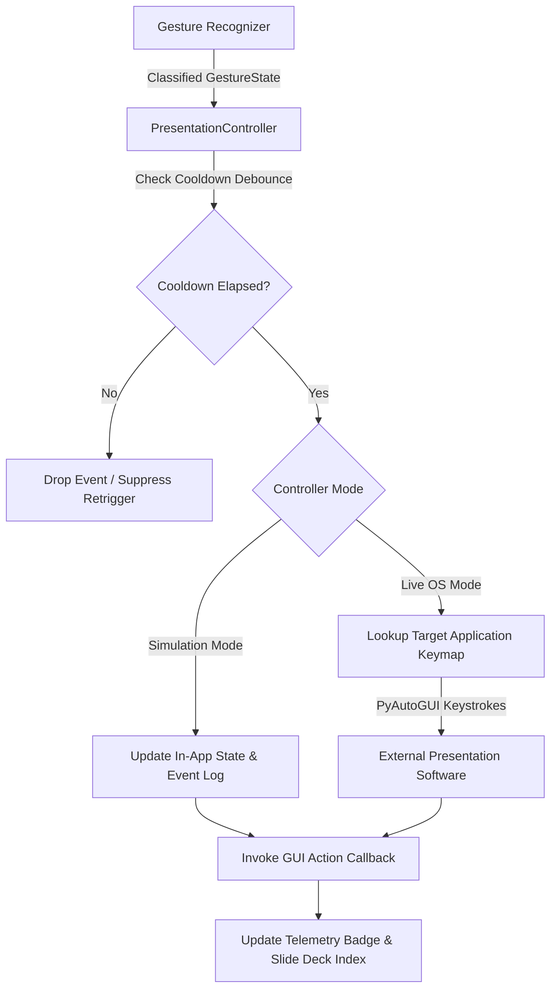

# Week 7: Presentation Controller Integration

## 1. Objectives
Implement OS-level presentation automation using **PyAutoGUI**, connecting recognized hand gestures directly to presentation software shortcuts (PowerPoint, Google Slides, Adobe Acrobat PDF, and Media Players). Introduce configurable target application profiles, debounce cooldown timers, internal slide tracking, and safe simulation mode.

---

## 2. Technical Architecture & Automation Pipeline

---

## 3. Presentation Profiles & Key Mappings

The presentation controller supports multiple target software profiles, automatically mapping abstract navigation intents into target-specific OS keystrokes:

| Action Name | Hand Gesture | PowerPoint | Google Slides | PDF Viewer | Media Player | General OS |
| :--- | :---: | :---: | :---: | :---: | :---: | :---: |
| **Next Slide** | 👉 `POINT_RIGHT` | `Right` / `PageDown` | `Right` | `Right` | `Right` (Seek +5s) | `Right` |
| **Previous Slide** | 👈 `POINT_LEFT` | `Left` / `PageUp` | `Left` | `Left` | `Left` (Seek -5s) | `Left` |
| **Toggle Fullscreen** | 👌 `OK_SIGN` | `F5` | `F` | `Ctrl + L` | `F` | `F11` |
| **Pause / Neutral** | ✊ `FIST` | `B` (Black Screen) | `B` | `Space` | `Space` (Play/Pause) | `Space` |
| **Volume Up** | 👍 `THUMBS_UP` | `VolumeUp` | `VolumeUp` | `VolumeUp` | `VolumeUp` | `VolumeUp` |
| **Volume Down** | 👎 `THUMBS_DOWN` | `VolumeDown` | `VolumeDown` | `VolumeDown` | `VolumeDown` | `VolumeDown` |
| **First Slide** | — | `Home` | `Home` | `Home` | `Home` | `Home` |
| **Last Slide** | — | `End` | `End` | `End` | `End` | `End` |
| **Exit Presentation** | — | `Esc` | `Esc` | `Esc` | `Esc` | `Esc` |

---

## 4. Debounce Engine & Cooldown Architecture

To prevent rapid, accidental slide skips caused by continuous gesture recognition:
1. Every discrete presentation action checks the timestamp elapsed since the previous action:
   $$\Delta t = t_{\text{current}} - t_{\text{last\_action}}$$
2. If $\Delta t < T_{\text{cooldown}}$ (where $T_{\text{cooldown}}$ is configurable from $0.5\text{s}$ to $2.0\text{s}$, default $1.0\text{s}$), the trigger is suppressed.
3. Continuous gestures such as `INDEX_POINTER` (laser pointer) and `PINCH` (drawing pen) bypass the discrete cooldown filter to allow continuous motion and real-time cursor tracking.

---

## 5. Dual-Mode Operation: Live OS vs. Simulation

To provide flexibility during preparation and testing:
- **Live OS Mode (`LIVE_OS`)**: Sends hardware-level simulated keystrokes via `pyautogui.press()` and `pyautogui.hotkey()`, actively controlling PowerPoint, Keynote, Google Slides, or Acrobat windows running in focus.
- **Simulation Mode (`SIMULATION`)**: Suppresses OS keystroke dispatch while updating internal slide state, telemetry badges, and the activity log. This allows presenters to rehearse gestures without unexpected key events interfering with other desktop apps.

---

## 6. Verification & Automated Testing

The presentation controller was verified using `tests/test_presentation_controller.py`:
- **Cooldown Debounce Verification**: Verified re-trigger suppression within cooldown window.
- **Profile Integrity**: Verified 100% keymap definitions across all 5 target software profiles.
- **State Progression**: Verified monotonic slide counter increment/decrement with boundary clamping.
- **Callback Dispatch**: Verified observer pattern notification upon successful action execution.
