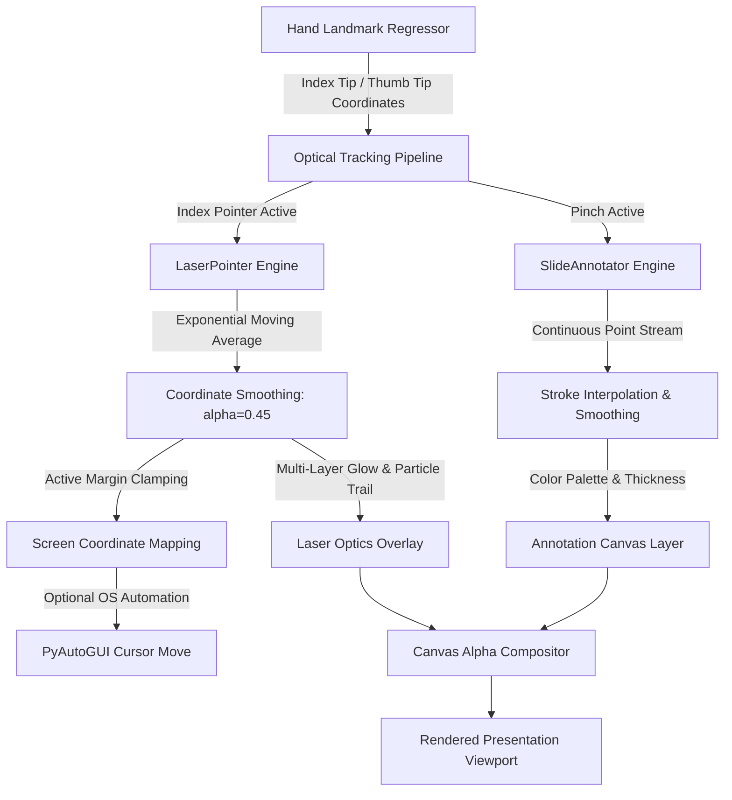

# Week 8: Virtual Laser Pointer & Drawing Mode

## 1. Objectives
Implement interactive on-screen presentation tools:
1. **Virtual Laser Pointer**: Track the index fingertip, apply low-pass Exponential Moving Average (EMA) coordinate smoothing, map normalized coordinates to full-screen coordinates, and render multi-layered glowing laser optics with trailing beam decay.
2. **Slide Drawing Canvas**: Track thumb-index pinch gestures to draw smooth freehand annotations on slides or live camera frames, supporting multi-color palettes, stroke thickness selection, undo operations, and canvas clearing.

---

## 2. Technical Architecture & Optical Pipeline

---

## 3. Virtual Laser Pointer Optics & Mathematical Model

### 3.1 Exponential Moving Average (EMA) Coordinate Smoothing
Hand tremor and webcam sensor jitter can cause distracting laser reticle vibration. The coordinate stream is stabilized using an EMA filter:

$$\hat{x}_t = \alpha \cdot x_t + (1 - \alpha) \cdot \hat{x}_{t-1}$$
$$\hat{y}_t = \alpha \cdot y_t + (1 - \alpha) \cdot \hat{y}_{t-1}$$

Where $\alpha \in [0.05, 0.95]$ is the smoothing factor (default $\alpha = 0.45$). Lower values provide cinematic smoothness; higher values provide snappy response.

### 3.2 Active Margin Boundary Clamping
In typical webcam setups, presenters cannot comfortably extend hands to the camera borders. An active tracking margin $m \in [0.10, 0.25]$ maps the inner $80\%$ of the camera frame to the $100\%$ display screen area:

$$x_{\text{clamped}} = \text{clamp}(x_t, m \cdot W_{\text{cam}}, (1 - m) \cdot W_{\text{cam}})$$

$$x_{\text{norm}} = \frac{x_{\text{clamped}} - m \cdot W_{\text{cam}}}{(1 - 2m) \cdot W_{\text{cam}}}$$

$$X_{\text{screen}} = x_{\text{norm}} \cdot W_{\text{screen}}$$

### 3.3 Multi-Layered Optical Glow Shader
The laser pointer is rendered using four concentric optical layers:
1. **Outer Atmospheric Halo**: Translucent disc ($r=22\text{px}$, alpha=0.22) blended via `cv2.addWeighted`.
2. **Diffraction Ring**: Outer accent border circle ($r=12\text{px}$, thickness=2).
3. **Solid Laser Core**: Intense saturated color circle ($r=6\text{px}$, filled).
4. **Hot White Core**: Pure white optical singularity center ($r=3\text{px}$, `#ffffff`).
5. **Decaying Particle Trail**: History buffer of past $N=8$ positions connected with anti-aliased lines with decaying thickness and intensity.

---

## 4. Slide Annotation & Freehand Drawing Engine

### 4.1 Pinch-Driven Drawing Lifecycle
- **Stroke Initiation**: When `d_norm(Thumb, Index) < 0.38` (Pinch gesture), a new `AnnotationStroke` is created at the midpoint $(\frac{x_T + x_I}{2}, \frac{y_T + y_I}{2})$.
- **Stroke Continuation**: Consecutive points are appended with duplicate distance filtering ($|\Delta x| \ge 2\text{px}$).
- **Stroke Completion**: When the pinch is released, the stroke concludes and is preserved in the stroke history stack.

### 4.2 Color Palette & Brush Customization
- **Color Presets**: Vibrant Neon Red, Electric Cyan, Neon Green, Golden Yellow, Purple, Pure White, and Eraser mode.
- **Stroke Thicknesses**: Fine (2px), Medium (4px), Thick (8px), and Bold (12px).
- **History Management**: Non-destructive `undo()` pops the most recent stroke; `clear()` wipes the entire annotation buffer.

---

## 5. Verification & Automated Testing

The laser pointer and annotator engines were validated using `tests/test_laser_and_annotator.py`:
- **Smoothing Test**: Verified EMA convergence toward target coordinates.
- **Screen Mapping Test**: Verified full range coverage within active bounding margins.
- **Stroke Lifecycle**: Verified point creation, distance filtering, undo operations, and clear actions.
- **Rendering Integrity**: Verified non-destructive array compositing onto OpenCV frame buffers.
