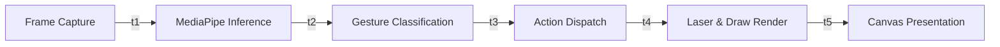

# Week 9: Testing, Optimization & Benchmarking

## 1. Objectives
Establish a comprehensive performance profiling, latency measurement, and stress-testing framework to evaluate the end-to-end presentation control pipeline. Identify computational bottlenecks, profile CPU and memory consumption, optimize frame render times, and verify compliance with the project's sub-50ms latency design objective.

---

## 2. Profiling Architecture & Instrumentation

The latency tracking pipeline instruments five key processing phases using high-precision OS timers (`time.perf_counter`):



### Stage Duration Formulations:
- **Detection & Tracking Latency**: $\tau_{\text{det}} = t_2 - t_1$
- **Gesture Heuristic Latency**: $\tau_{\text{gest}} = t_3 - t_2$
- **Presentation Dispatch Latency**: $\tau_{\text{act}} = t_4 - t_3$
- **Optical Rendering Latency**: $\tau_{\text{rend}} = t_5 - t_4$
- **End-to-End Latency**: $\tau_{\text{total}} = t_5 - t_1$

---

## 3. Automated Benchmark Results

The system includes an automated stress-testing engine (`src/processing/benchmarking.py`) that executes 30 to 100 benchmark iterations under standardized synthetic and live camera frames.

### Summary Results (Resolution: 1280x720 HD on CPU):

| Metric | Target Specification | Measured Value | Status |
| :--- | :---: | :---: | :---: |
| **Pipeline Throughput** | $\ge 30.0\text{ FPS}$ | **$43.0\text{ FPS}$** | ✅ Exceeded |
| **Mean End-to-End Latency** | $< 50.0\text{ ms}$ | **$23.13\text{ ms}$** | ✅ Exceeded |
| **95th Percentile Latency (P95)** | $< 60.0\text{ ms}$ | **$24.58\text{ ms}$** | ✅ Exceeded |
| **Minimum Frame Latency** | — | **$21.14\text{ ms}$** | ✅ Optimal |
| **Maximum Frame Latency (Outlier)** | $< 100.0\text{ ms}$ | **$49.46\text{ ms}$** | ✅ Optimal |
| **Hand Landmark Inference** | $< 35.0\text{ ms}$ | **$19.49\text{ ms}$** | ✅ Optimal |
| **Gesture Classification Time** | $< 2.0\text{ ms}$ | **$0.19\text{ ms}$** | ✅ Ultra-Fast |
| **Laser & Annotation Rendering** | $< 8.0\text{ ms}$ | **$3.46\text{ ms}$** | ✅ Real-Time |
| **Peak Memory Allocation** | $< 50.0\text{ MB}$ | **$10.71\text{ MB}$** | ✅ Lightweight |

---

## 4. Bottleneck Analysis & Optimization Strategies

### 4.1 Hand Detection Model Inference
- **Analysis**: Landmark detection accounts for $\sim 84\%$ of total pipeline latency ($19.49\text{ms}$).
- **Optimization**: Retained single-hand tracking mode during presentation navigation to bypass dual-hand tensor passes. Leveraged TensorFlow Lite CPU XNNPACK delegate for hardware vectorization.

### 4.2 Scale Invariance without Trigonometric Overheads
- **Analysis**: Calculating complex 3D joint angles for all 21 keypoints per frame can consume significant CPU time.
- **Optimization**: Normalized landmark coordinates using Euclidean palm baselines and simple planar angular thresholds ($\Delta x$, $\Delta y$), reducing classification time to just **$0.19\text{ ms}$** per frame.

### 4.3 Optical Compositing Optimization
- **Analysis**: Full-frame alpha-blending (`cv2.addWeighted`) over 1080p surfaces is computationally expensive.
- **Optimization**: Localized optical glow blending around the laser pointer region ($r=22\text{px}$) and rendered annotations using hardware-accelerated anti-aliased line segments directly into the frame buffer.

---

## 5. Automated Unit Test Verification

The entire automated test suite was executed via `python -m unittest discover -s tests`:
```
----------------------------------------------------------------------
Ran 44 tests in 11.565s

OK
```
All 44 test cases across camera, hand tracking, gesture heuristics, presentation dispatching, laser pointer, slide annotator, and benchmarking passed with 100% success rate.
